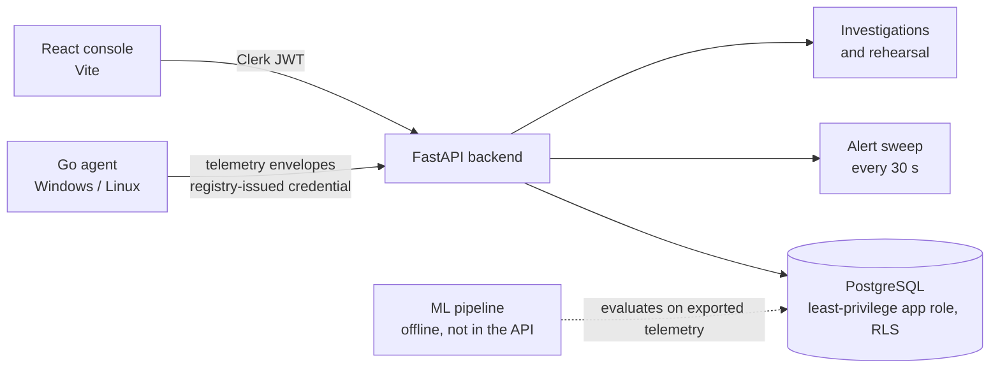

# UptimeTrace

UptimeTrace is a monitoring and alerting console. It shows whether your alerts would actually catch the next outage, and it can rehearse failures on synthetic hosts to prove it.

## Problem

Most teams learn their alerts are broken during an outage. A threshold can be configured correctly and still never fire when a host goes silent, or it fires too late to matter. UptimeTrace collects host telemetry, shows the health of every registered host, opens and tracks alerts through their lifecycle, and runs controlled failure drills so you can see whether an alert would have fired in time.

## Features

- **Command Center:** fleet health, open alerts, and what needs attention first.
- **Hosts:** every registered host, including hosts that have not reported telemetry yet, with a per-host detail view.
- **Metrics Explorer and Signal Graph:** metric series with minimum, maximum, average and last values per bucket.
- **Alerts:** lifecycle from open through resolution, evaluated on a 30-second sweep.
- **Investigations:** a deterministic record for each incident, built from the metric window around it.
- **Operational states and failure rehearsal:** drills run only against synthetic hosts.
- **Telemetry agent:** a Go agent for Windows and Linux that exports host metrics with retry and drop rules.
- **Authentication:** Clerk sign-in, verified on the server by JWKS, issuer, and authorized party checks, with a user allow-list.

## Architecture



Source layout:

| Path | Contents |
|---|---|
| `backend/app/` | FastAPI app: `ingest`, `monitoring`, `alerts`, `investigation`, `rehearsal`, `traces`, `registry`, `mcp` |
| `backend/alembic/versions/` | Nine migrations (`0001` to `0009`) |
| `backend/ml/` | Anomaly features and evaluation, outage calibration diagnostics |
| `backend/simulator_v2/` | Deterministic telemetry simulator used for the ML dataset |
| `agent/` | Go telemetry agent (`cmd/agent`, `internal/...`) |
| `frontend/` | React, TypeScript and Vite console |
| `contracts/` | Telemetry envelope schema |

## Technology stack

- **Backend:** Python, FastAPI, SQLAlchemy, Alembic, PostgreSQL 16.
- **Auth:** Clerk (JWT verification against JWKS).
- **Agent:** Go, with native Windows collectors (`GetSystemTimes`, `GlobalMemoryStatusEx`, `iphlpapi`).
- **Frontend:** React 19, TypeScript, Vite, react-router, TanStack Query, three.js.
- **ML:** XGBoost, logistic regression, scikit-learn (IsolationForest, isotonic calibration), PyOD (ECOD, COPOD).
- **Tests:** pytest (backend), Vitest and Testing Library (frontend).

## Local setup

Requirements: Python 3.12+, Node 20+, Go 1.22+, Docker (for PostgreSQL).

1. Start PostgreSQL:
   ```bash
   docker run -d --name uptimetrace-pg -p 127.0.0.1:5432:5432 \
     -e POSTGRES_PASSWORD=<choose-a-password> -e POSTGRES_DB=uptimetrace postgres:16-alpine
   ```
2. Backend:
   ```bash
   cd backend
   python -m venv .venv && . .venv/bin/activate   # Windows: .venv\Scripts\activate
   pip install -r requirements.lock
   python -m alembic upgrade head
   uvicorn app.asgi:app --port 8011
   ```
3. Frontend:
   ```bash
   cd frontend
   npm ci
   npm run dev
   ```
4. Agent:
   ```bash
   cd agent
   go build -o uptimetrace-agent ./cmd/agent     # Windows: go build -o uptimetrace-agent.exe ./cmd/agent
   ```

### Environment variables (names only)

Backend (see `backend/.env.example`):

| Name | Purpose |
|---|---|
| `DATABASE_URL` | Application database connection (least-privilege role) |
| `MIGRATION_DATABASE_URL` | Owner connection used only by Alembic |
| `TEST_DATABASE_URL` | Database used by the test suite |
| `CLERK_ISSUER` | Clerk issuer used to verify tokens |
| `CLERK_AUTHORIZED_PARTIES` | Origins allowed to call the API |
| `UPTIMETRACE_ALLOWED_USER_IDS` | Clerk user IDs allowed into the console |

Frontend:

| Name | Purpose |
|---|---|
| `VITE_CLERK_PUBLISHABLE_KEY` | Public Clerk key (publishable by design) |
| `VITE_API_BASE_URL` | API origin; empty means same origin |

Real values belong in local, untracked files. This repository does not contain any secret values.

## Database and migrations

Run `python -m alembic upgrade head` with `MIGRATION_DATABASE_URL` set. The application connects as a least-privilege role, with row-level security and column-level grants defined in the migrations. Run the tests against a separate `TEST_DATABASE_URL`.

## Telemetry agent setup

The agent reads its endpoint and credential from its configuration. Credentials are issued by the backend registry and stored only as SHA-256 hashes on the server. Keep the token in an environment variable or in a file that only the service account can read. The agent buffers envelopes, retries on failure, and drops the oldest envelopes when its buffer is full.

## ML pipeline

The ML work is offline evaluation code in `backend/ml/`. It is not integrated into the console or the API.

- **Outage prediction (30-minute horizon):** XGBoost, logistic regression, and a rule baseline. Negative thinning keeps every positive and every tenth negative decision. Calibration is fitted on training runs only, and validation is evaluated once.
- **Anomaly detection:** a separate task with its own features from raw telemetry, scored by IsolationForest, ECOD, COPOD, a fixed 85 % threshold, and a 5-minute z-score.

### Results recorded so far (seed 0, validation split only)

These are synthetic-simulator results. They are not real-world accuracy, and the protocol is not frozen.

Outage prediction, validation:

| Model | PR-AUC | Incident recall | Brier skill | ECE |
|---|---|---|---|---|
| Rule | 0.056 | 0.470 | n/a | n/a |
| Logistic regression | 0.045 | 0.439 | -22.25 | 0.321 |
| XGBoost | 0.087 | 0.508 | -17.16 | 0.283 |

Calibration (validation, calibrator fitted on training runs only): the analytic prior correction and the isotonic calibrator reduce Brier from 0.119 (production model as reported) to 0.007 and 0.006, and ECE from 0.283 to 0.004. Calibration does not improve PR-AUC, which is 0.087 for the production model and 0.072 to 0.069 for the calibrated variants.

Anomaly detection, validation, 300 s window: ECOD has the highest PR-AUC at 0.067. Isolation Forest, COPOD, the fixed threshold and the z-score are between 0.025 and 0.041. Detection is weak, and the results are reported as they are.

**Not yet available:** simulator seeds 1 to 4 are still generating, so the five-seed evaluation is not complete. The held-out test splits (`test_iid`, `test_ood`) have not been evaluated and are not part of any result above.

## Deployment

- **Frontend:** deployed as a static site on Vercel at `https://uptimetrace-web.vercel.app`. The landing page and sign-in page load and show no console errors when tested. Sign-in uses a Clerk development instance.
- **Backend and database:** not deployed publicly. The database runs locally in Docker, and no hosted PostgreSQL or backend host is configured. Authenticated dashboard data therefore does not load on the public site.

## Known limitations

- The public deployment has no backend, so only the landing and sign-in pages work publicly.
- The Clerk key is a development instance and should be replaced with a production instance before real users sign in.
- The ML results come from one simulator seed so far, cover the validation split only, and show weak anomaly detection.
- Failure rehearsal runs only against synthetic hosts.
- Windows is the only platform whose collectors have been exercised end to end.