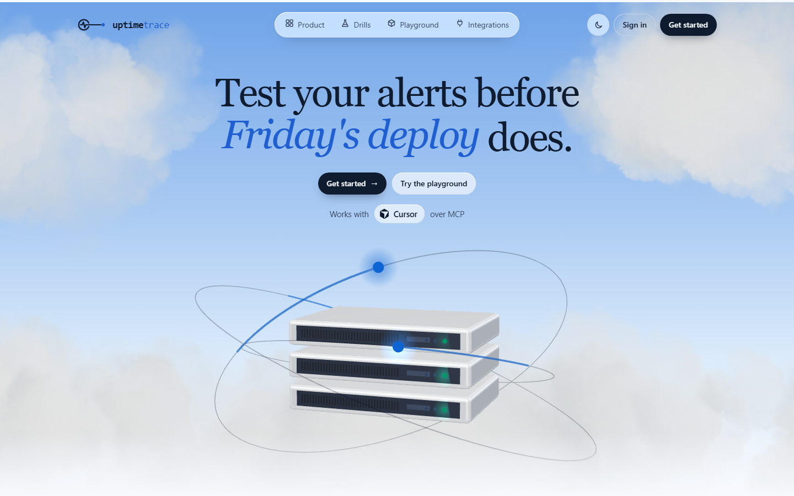
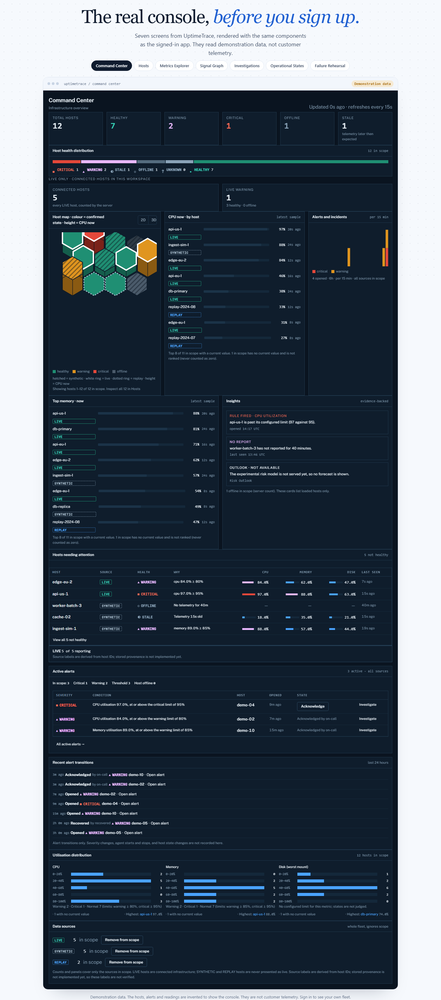
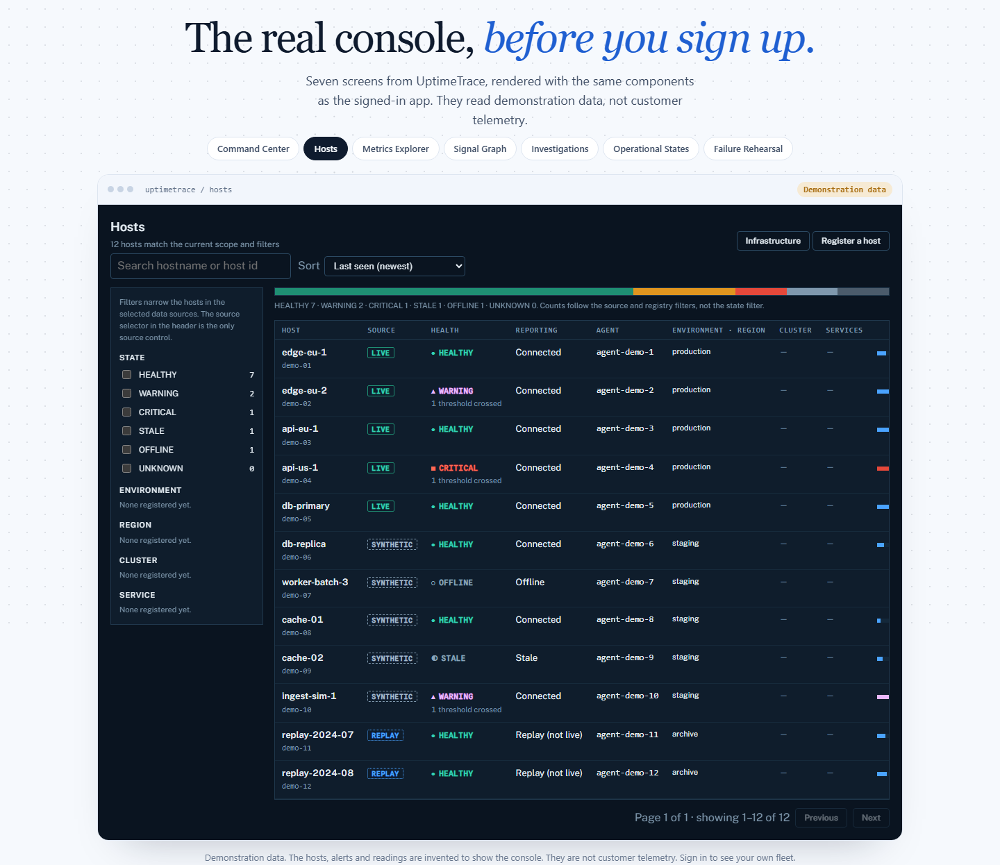
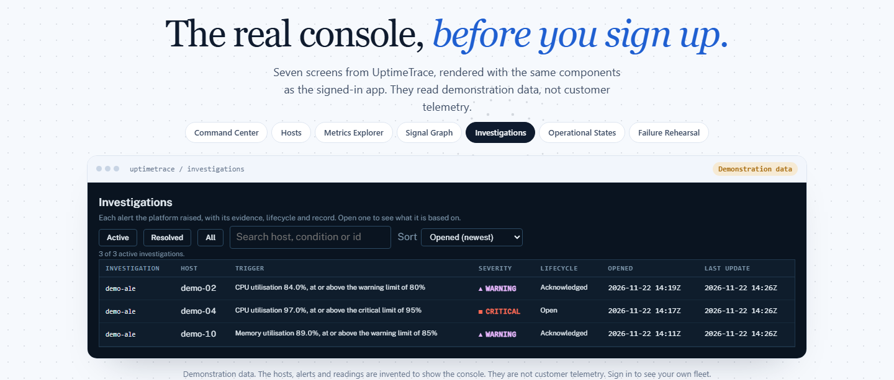
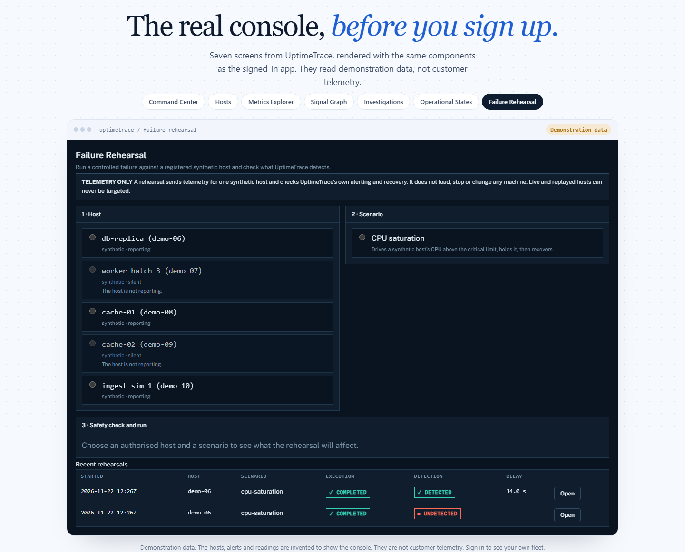
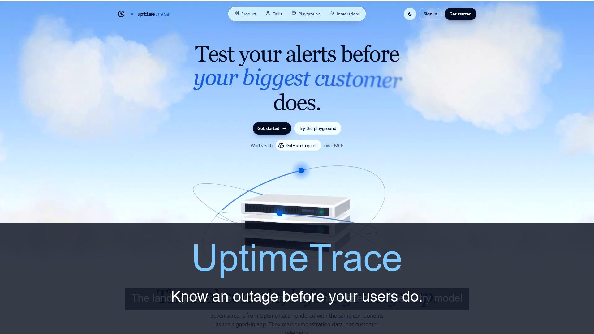
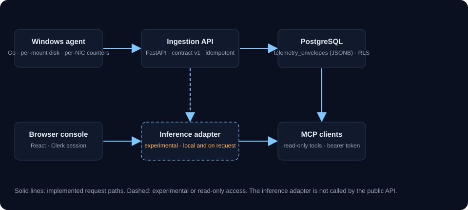
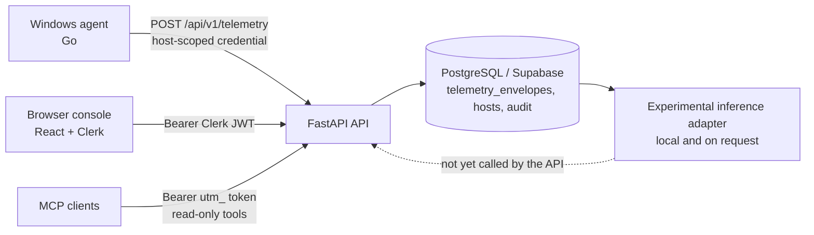
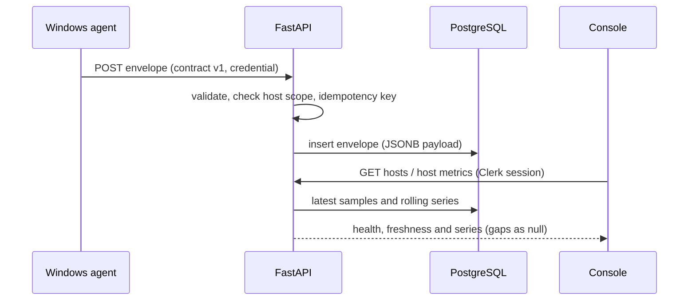

<div align="center">


### Know an outage before your users do.


UptimeTrace is an infrastructure observability console with telemetry ingestion, host-level health, alerting, failure rehearsal on synthetic hosts, a read-only MCP interface for AI clients, and an experimental outage-risk model.

[Live console](https://uptimetrace-web.vercel.app) · [API health](https://uptimetrace-api.vercel.app/health) · [Demo video](#demo) · [Architecture](docs/ARCHITECTURE.md) · [Evaluation](docs/EVALUATION.md)


</div>

---

## Status at a glance

| Area | Status |
|---|---|
| Public landing page and sign-in | **Deployed** (`uptimetrace-web.vercel.app`) |
| Public API health and database check | **Deployed** (`uptimetrace-api.vercel.app/health`) |
| Telemetry ingestion from the Windows agent | **Working** (hosted and local) |
| Host inventory, health and metrics | **Working** locally; the authenticated dashboard is not reachable from this demo without a Clerk session |
| MCP read-only tools | **Deployed**, requires a bearer token; verified with the official Python SDK and Claude Code |
| Experimental outage-risk score | **Local and on request only**; not in the public API or dashboard |
| Anomaly detection (ECOD) | **Locally verified only**; artifact not deployed |
| Production authentication | **Not configured** (Clerk development instance) |

## Why

Dashboards show what already happened. Most teams learn their alerts are broken during an outage: a threshold never fires, or fires after the damage is done. UptimeTrace records telemetry for every host, classifies health without assuming missing data is zero, and runs controlled failure rehearsals on synthetic hosts so you can see whether an alert would have fired in time.

## Screenshots

These are from the public landing page. Its product showcase renders the real console components with **demonstration data**, which the page labels as such. They are not customer data.

<p align="center">
  <br>
  <sub>Landing hero (public site).</sub>
</p>

<p align="center">
  
  <br>
  <sub>Command Center and Hosts (demonstration data, landing showcase).</sub>
</p>

<p align="center">
  
  <br>
  <sub>Investigations and failure rehearsal (demonstration data, landing showcase).</sub>
</p>

Host Detail is not in this set yet: it needs a signed-in session to show live host data, and no demonstration version is included. Risk Outlook currently shows "not available yet" for its forecast. This is deliberate: the experimental score is not served to the dashboard.

## Demo

<p align="center">
  
</p>

A 2 minute 26 second walkthrough, recorded from the public site. It shows the landing hero, the showcase views (demonstration data), the sign-in page, and the experimental ML and architecture summary cards. It does **not** show the authenticated dashboard, which needs a signed-in session. The MP4 (16 MB) is not stored in this repository; it is published separately from the repository.

## Core capabilities

**Implemented and tested**

- **Telemetry ingestion.** A versioned envelope contract (`contracts/telemetry/v1`), with validation, host-scoped credentials, and idempotent storage keyed by envelope ID and content hash.
- **Host observability.** CPU, memory, per-mount disk and per-interface network metrics. Missing samples are shown as gaps, never as zero.
- **Health classification.** `healthy`, `warning`, `critical`, `offline`, `stale` and `unknown`, with thresholds returned in every response.
- **Alerts and incidents.** Alert lifecycle is evaluated on each ingest (see the serverless note under Deployment).
- **Failure rehearsal.** Controlled faults on registered synthetic hosts only; the rehearsal records what was sent and what the database read back.
- **Read-only MCP server.** Three tools for hosts, health and metrics, behind per-token scopes, expiry, revocation, workspace isolation and a rate limit.
- **Windows telemetry agent.** Native Windows collectors for CPU, memory, per-mount disk and per-interface network counters, with buffering and retry.

**Experimental (not part of the public product)**

- **Outage-risk score (30-minute horizon).** A saved XGBoost model, its schema and its validation threshold, applied to telemetry stored for a host. Output is a `risk_score`, labelled experimental. It is not a calibrated probability.
- **ECOD anomaly detector.** Exported from the training split only, with exact parity against its evaluation path on validation rows. Its 62.7 MB artifact is git-ignored and not deployed.

## Architecture

<p align="center"></p>



Component detail, the database access model and the health semantics are in [`docs/ARCHITECTURE.md`](docs/ARCHITECTURE.md).

## How it works



## Machine learning

The ML work is evaluated on **synthetic telemetry** from the repository's simulator, with fault-injection labels. No public dataset is used. Results are validation-only; no held-out test split has been opened, and the five-seed evaluation is not complete.

- Methodology: [`docs/ML_METHODOLOGY.md`](docs/ML_METHODOLOGY.md)
- Results and their limits: [`docs/EVALUATION.md`](docs/EVALUATION.md)
- Protocol: [`docs/ML_EVALUATION_PROTOCOL.md`](docs/ML_EVALUATION_PROTOCOL.md) (not frozen)

Three things are kept separate:

1. **Offline evaluation.** Training and scoring on exported datasets in `backend/ml/`.
2. **Experimental live inference.** The adapter in `backend/app/ml_inference/` reads stored telemetry for a host and returns a score, or the reasons it cannot. It fails closed when history is under one hour, a series is stale, or the disk-role mapping is missing or ambiguous.
3. **Public product.** No ML output appears in the deployed dashboard or API.

Example from the hosted telemetry (single reading, not an evaluation): host `web-10` scored `0.0071` against a validation threshold of `0.905`.

## MCP integration

- **Endpoint:** `https://uptimetrace-api.vercel.app/mcp/` (Streamable HTTP, stateless JSON responses).
- **Authentication:** a bearer token generated in the console's Integrations page. Tokens are 256-bit random values, stored only as SHA-256 hashes, with scopes, expiry and revocation.
- **Tools:** `list_hosts`, `get_host_health`, `get_host_metrics`. All read-only.
- **Verified:** tool discovery and calls over HTTPS with the official `mcp` Python SDK, and tool invocation from Claude Code.
- **Not verified:** Claude Desktop and ChatGPT. ChatGPT's custom connectors may require OAuth, which this server does not implement.

Full setup and limits: [`docs/MCP_INTEGRATION.md`](docs/MCP_INTEGRATION.md).

## Technology

- **Backend:** Python 3.12, FastAPI, SQLAlchemy 2, Alembic, psycopg 3, PyJWT, the `mcp` SDK.
- **Database:** PostgreSQL (local Docker for development; Supabase for the hosted deployment).
- **Frontend:** React 19, TypeScript, Vite, React Router, TanStack Query, three.js, Clerk.
- **Agent:** Go 1.22.
- **ML (offline and adapter):** XGBoost, NumPy, pandas, scikit-learn, pyod (ECOD), pyarrow.
- **Hosting:** Vercel (frontend and API), Supabase (database), Clerk (authentication).

## Quickstart

Prerequisites: Python 3.12, Node 20+, Go 1.22+, Docker (for local PostgreSQL).

```bash
git clone https://github.com/redcode333/UptimeTrace.git
cd UptimeTrace
```

**1. Database.** Use any PostgreSQL 16 instance. For a local one:

```bash
docker run -d --name uptimetrace-pg -p 127.0.0.1:5432:5432 \
  -e POSTGRES_PASSWORD=<choose-a-password> -e POSTGRES_DB=uptimetrace postgres:16-alpine
```

**2. Backend.** Copy `backend/.env.example` to `backend/.env` and fill in the placeholders (names are listed below).

```bash
cd backend
python -m venv .venv && . .venv/bin/activate       # Windows: .venv\Scripts\activate
pip install -e ".[dev]"
python -m alembic upgrade head
uvicorn app.asgi:app --port 8011
```

**3. Frontend.** Copy `frontend/.env.example` to `frontend/.env` if present, then:

```bash
cd frontend
npm ci
npm run dev
```

**4. Agent (Windows).**

```bash
cd agent
go build -o uptimetrace-agent.exe ./cmd/agent
```

Register a host and issue its credential from the console (Onboarding, then Agents), then run the agent with `UPTIMETRACE_URL`, `UPTIMETRACE_HOST_ID` and `UPTIMETRACE_TOKEN_FILE` set to the token file's path.

**Tests:**

```bash
cd backend && python -m pytest -q        # backend
cd frontend && npm run typecheck && npm test
```

### Environment variable names

Values are never stored in the repository.

| Name | Where | Purpose |
|---|---|---|
| `DATABASE_URL` | backend | Application connection (least-privilege role) |
| `MIGRATION_DATABASE_URL` | backend, local only | Owner connection for Alembic; never deploy it to the API |
| `TEST_DATABASE_URL` | backend | Separate database for tests |
| `CLERK_ISSUER`, `CLERK_AUTHORIZED_PARTIES`, `UPTIMETRACE_ALLOWED_USER_IDS` | backend | Clerk verification, CORS origins, user allow-list |
| `MCP_ENABLED`, `MCP_PUBLIC_URL`, `MCP_ALLOWED_HOSTS`, `CONSOLE_BASE_URL` | backend | Opt-in MCP endpoint and console links |
| `VITE_CLERK_PUBLISHABLE_KEY`, `VITE_API_BASE_URL`, `VITE_MCP_PUBLIC_URL` | frontend | Build-time public configuration |
| `UPTIMETRACE_URL`, `UPTIMETRACE_HOST_ID`, `UPTIMETRACE_TOKEN_FILE` | agent | Where to send telemetry and its credential |

Migrations: `python -m alembic upgrade head` (current head is revision 0009). Details: [`docs/MIGRATIONS.md`](docs/MIGRATIONS.md).

## Deployment

- **Frontend:** Vercel static site, `https://uptimetrace-web.vercel.app`.
- **API:** Vercel Python function, `https://uptimetrace-api.vercel.app`. `/health` returns `ok` for the app and the database.
- **Database:** hosted Supabase PostgreSQL, reached as `uptimetrace_app` over TLS.
- **Authentication:** Clerk **development** instance. Production is not configured.

Serverless limits: there is no background worker, so the periodic alert sweep does not run; alerts are evaluated on ingest. The API uses a slim requirements file that excludes ML training packages. The ML inference adapter and the ECOD artifact are not part of the deployed API.

Full details, verification checks and limitations: [`docs/DEPLOYMENT.md`](docs/DEPLOYMENT.md).

## Security

- **Browser API:** Clerk JWTs verified against the issuer's JWKS, with issuer and authorized-party checks and a user allow-list. Failure closes the request.
- **Agent ingestion:** host-scoped credentials, stored as hashes; a live credential cannot target a reserved synthetic prefix.
- **MCP:** bearer tokens stored as SHA-256 hashes, shown once, scoped, expiring, revocable, rate limited (60 calls per minute per token), audited.
- **Database:** RLS is enabled on the application tables. No grants to the public Data-API roles. The application role is `uptimetrace_app`, which has **broader UPDATE and DELETE grants on several tables than the minimum**; this was accepted for the submission and should be reviewed. The owner role is used only for migrations.
- **Secrets:** `.env` files and token files are not committed. The public frontend bundle contains only public configuration.
- **Known gaps:** TLS verifies encryption but not the server certificate; the Clerk instance is a development one.

## Project structure

```
UptimeTrace/
├── agent/                     Go telemetry agent (cmd/agent, internal/collector, exporter, buffer)
├── backend/
│   ├── app/                   FastAPI app: ingest, monitoring, registry, mcp, alerts,
│   │   │                      investigation, rehearsal, traces, ml_inference
│   ├── alembic/versions/      migrations 0001–0009
│   ├── ml/                    offline features, labels, baselines, evaluation, ECOD export
│   ├── simulator_v2/          deterministic telemetry simulator
│   └── tests/
├── contracts/telemetry/v1/    envelope schema
├── frontend/                  React console, landing page, showcase
├── artifacts/                 evaluation outputs and saved model artifacts
├── docs/                      architecture, ML, evaluation, MCP, deployment, security
└── README.md
```

## Roadmap

**Completed**
- Telemetry contract, ingestion, host registry, health classification, read API.
- Windows agent with native collectors.
- Read-only MCP server with token management; verified over HTTPS and from Claude Code.
- Public frontend and API deployment; hosted database at revision 0009.
- Offline ML evaluation on synthetic seed 0 (validation split).
- Live inference adapter, verified for feature parity and score parity, and tested against hosted telemetry.

**In progress**
- Review of the proposed `ml_inferences` migration. The review package is kept outside the repository and the migration is not applied.

**Planned**
- Persistence of inference results, authenticated ML endpoints, and dashboard panels for ML outputs.
- Production Clerk instance.
- Five-seed evaluation and held-out evaluation, after protocol freeze approval.
- Stored per-host disk-role mapping in the console.
- Repository-tracked deployment configuration for the API.

## Contributing

Issues and pull requests are welcome. Keep changes scoped to one concern, run the backend and frontend test commands above, and do not commit secrets, token files or generated model artifacts. Describe any change to telemetry contract or database grants explicitly in the pull request.

## License

No license file is present in this repository yet. Until one is added, all rights are reserved by the author.
